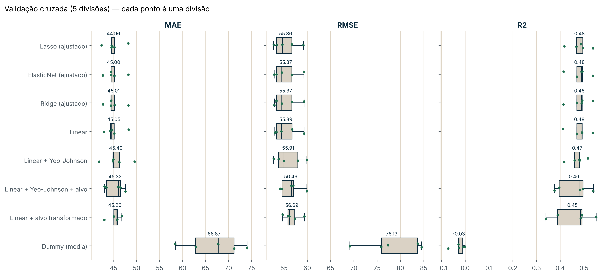
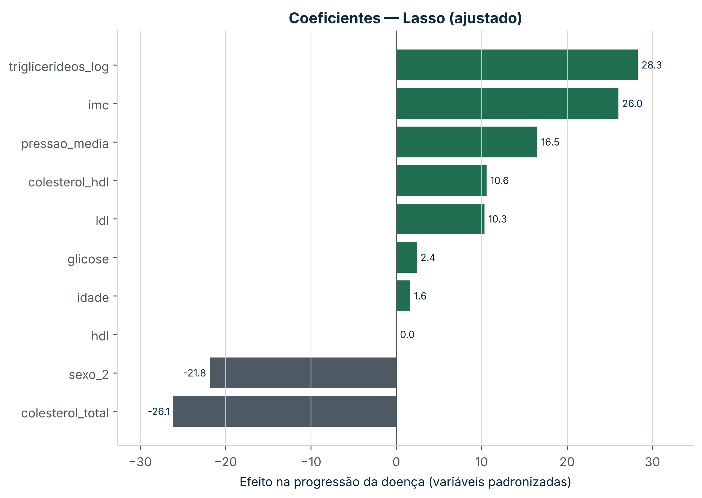

# Regressão com modelos lineares — progressão da diabetes

*Predicting one-year diabetes progression with linear models in scikit-learn: pipelines, cross-validation and regularisation. Test R² 0.46.*



**Resultado principal:** o melhor modelo (Lasso) prevê a progressão da doença com um erro médio de **43 pontos** (MAE) e explica **46 %** da variação no conjunto de teste. A linha de base, que prevê sempre a média, não explica nada (R² ≈ 0).

## Objetivo

Prever, a partir de 10 medições iniciais (idade, sexo, IMC, pressão arterial e seis análises ao sangue), a progressão da diabetes um ano depois, e perceber que variáveis pesam mais.

## Dados

442 doentes do estudo de Efron et al. (2004), na versão sem padronização do scikit-learn. Fonte e licença em [`referencias/02_fontes.md`](referencias/02_fontes.md); significado das colunas em [`referencias/01_dicionario_de_dados.md`](referencias/01_dicionario_de_dados.md).

## Método

1. **Análise exploratória** ([`01-jr-eda-diabetes`](notebooks/01-jr-eda-diabetes.ipynb)): tipos, valores em falta, distribuições, valores extremos e correlações de Spearman.
2. **Modelação** ([`02-jr-modelos-lineares`](notebooks/02-jr-modelos-lineares.ipynb)):
   - 20 % dos dados reservados para teste, usados uma única vez no fim;
   - comparação no treino com validação cruzada KFold (5 divisões): `DummyRegressor`, regressão linear com padronização ou Yeo-Johnson, e com o alvo transformado;
   - Ridge, Lasso e ElasticNet ajustados com `GridSearchCV`;
   - escolha pelo menor RMSE médio, curva de aprendizagem, coeficientes e resíduos.

## Resultados

Validação cruzada no treino (média de 5 divisões):

| Modelo | MAE | RMSE | R² |
|---|---|---|---|
| Lasso (ajustado, α = 0,17) | 44,96 | 55,36 | 0,48 |
| Ridge (ajustado) | 45,01 | 55,37 | 0,48 |
| Regressão linear | 45,05 | 55,39 | 0,48 |
| Linear + alvo transformado | 45,26 | 56,69 | 0,45 |
| Dummy (média) | 66,87 | 78,13 | −0,03 |

Teste (89 doentes), modelo Lasso: **MAE 42,84 · RMSE 53,67 · R² 0,46**.



- Os triglicerídeos, o IMC e a pressão média são as variáveis com mais peso.
- Pré-processamento, transformação do alvo e regularização mudam pouco: as diferenças ficam dentro da variação entre divisões.
- A curva de aprendizagem estabiliza; mais doentes com as mesmas variáveis pouco ajudariam.

## Limitações

- 442 doentes de um único estudo; o significado da codificação do sexo não é conhecido.
- O modelo é associativo, não causal.
- Variáveis do sangue muito correlacionadas (colesterol total e LDL: 0,88), por isso os coeficientes individuais não se interpretam isoladamente.
- O modelo subestima as progressões mais altas e sobrestima as mais baixas.

## Como reproduzir

```bash
conda env create -f ambiente.yml
conda activate hashtag-ml
cd notebooks
jupyter lab
```

Correr os notebooks pela ordem. O `01` descarrega os dados para `dados/brutos/` (fora do Git); todos os números e figuras são gerados pelos notebooks (semente 42).

## Organização

```
├── ambiente.yml
├── dados/
│   ├── brutos/          diabetes_original.csv (fora do Git)
│   └── processados/     base tratada, resultados da validação cruzada e métricas de teste
├── modelos/             modelo_final.joblib
├── notebooks/
│   ├── 01-jr-eda-diabetes.ipynb
│   ├── 02-jr-modelos-lineares.ipynb
│   └── src/             config.py, modelos.py, graficos.py
├── referencias/         dicionário de dados e fontes
└── relatorios/imagens/  figuras geradas pelos notebooks
```

---

<sub>Projeto do módulo 14 do curso Ciência de Dados Impressionador (Hashtag Treinamentos), feito com a minha própria organização e análise.</sub>
