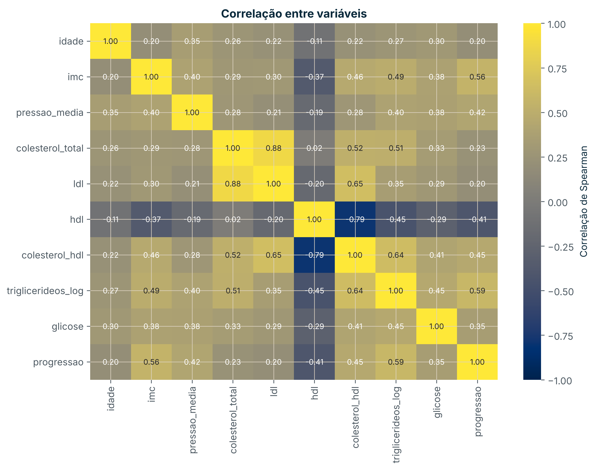
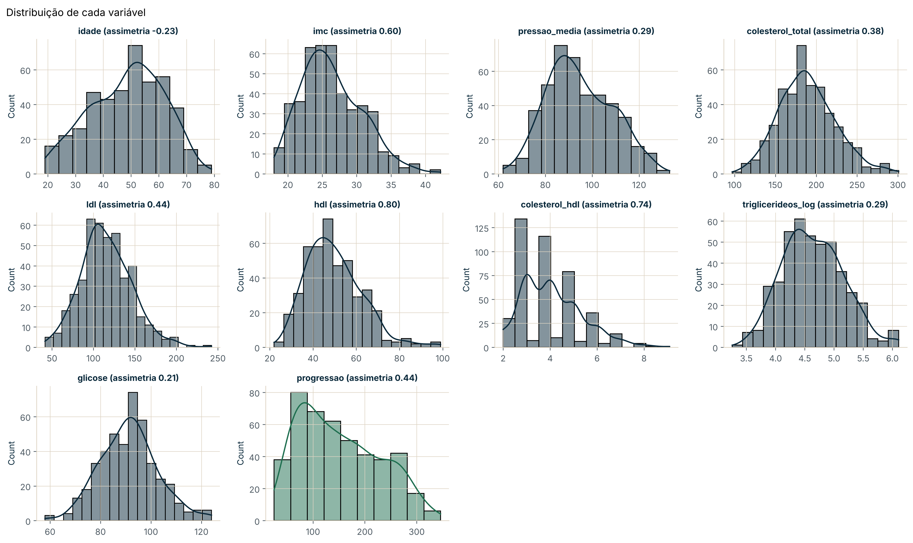

# Análise exploratória da base diabetes

*Exploratory data analysis of the diabetes dataset (442 patients): distributions, outliers and correlations with disease progression.*



**Resultado principal:** os triglicerídeos (correlação de Spearman 0,59) e o IMC (0,56) são as variáveis mais associadas à progressão da diabetes um ano depois; o HDL tem associação negativa (−0,41).

## Objetivo

Conhecer a base antes de qualquer modelo: tipos, valores em falta, duplicados, distribuições, valores extremos e correlações com o alvo.

## Dados

442 doentes do estudo de Efron et al. (2004), na versão sem padronização do scikit-learn. Fonte em [`referencias/02_fontes.md`](referencias/02_fontes.md); significado das colunas em [`referencias/01_dicionario_de_dados.md`](referencias/01_dicionario_de_dados.md).

## Método

Notebook [`01-jr-eda-diabetes`](notebooks/01-jr-eda-diabetes.ipynb): renomear colunas, verificar valores em falta e duplicados, histogramas, caixas de bigodes (critério 1,5 × IQR), mapa de correlações de Spearman e comparação por sexo. A base tratada é exportada para `dados/processados/`.

## Resultados

- Sem valores em falta nem duplicados.
- O alvo tem assimetria positiva: há mais doentes com progressão baixa.
- Poucos valores extremos, todos plausíveis; ficam na base.
- Colesterol total e LDL muito correlacionados (0,88); o rácio colesterol/HDL e o HDL também (−0,79).
- A progressão é parecida nos dois sexos.



## Limitações

- 442 doentes de um único estudo; não se sabe qual sexo corresponde a cada código.
- Correlações não indicam causa.

## Como reproduzir

```bash
conda env create -f ambiente.yml
conda activate estudos-ds
cd notebooks
jupyter lab
```

O notebook descarrega os dados para `dados/brutos/` (fora do Git).
